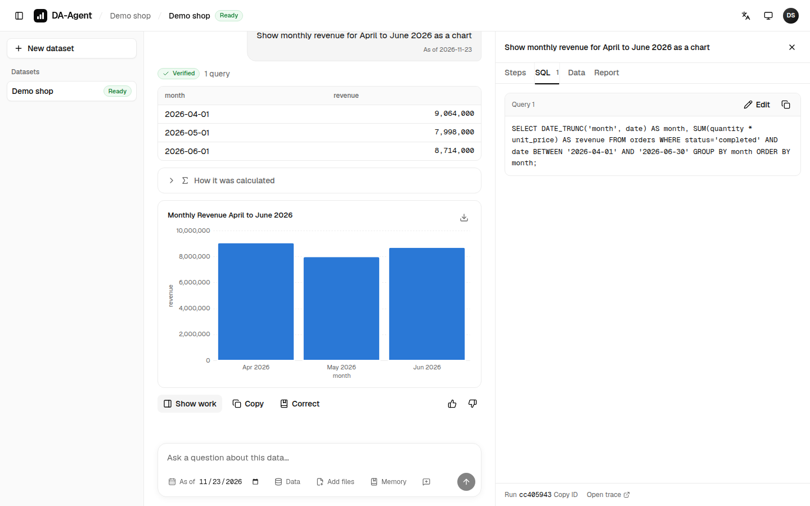
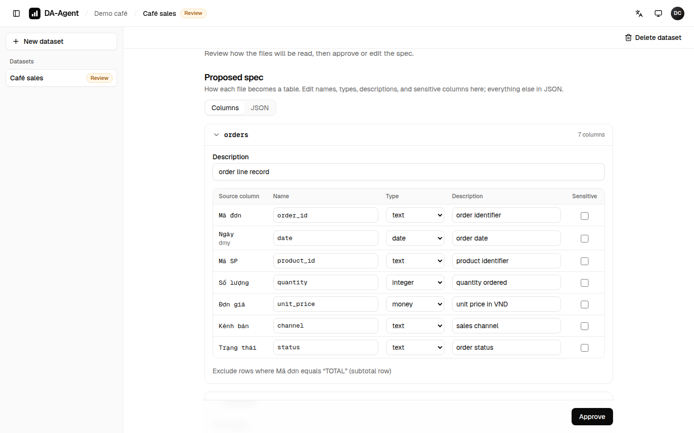
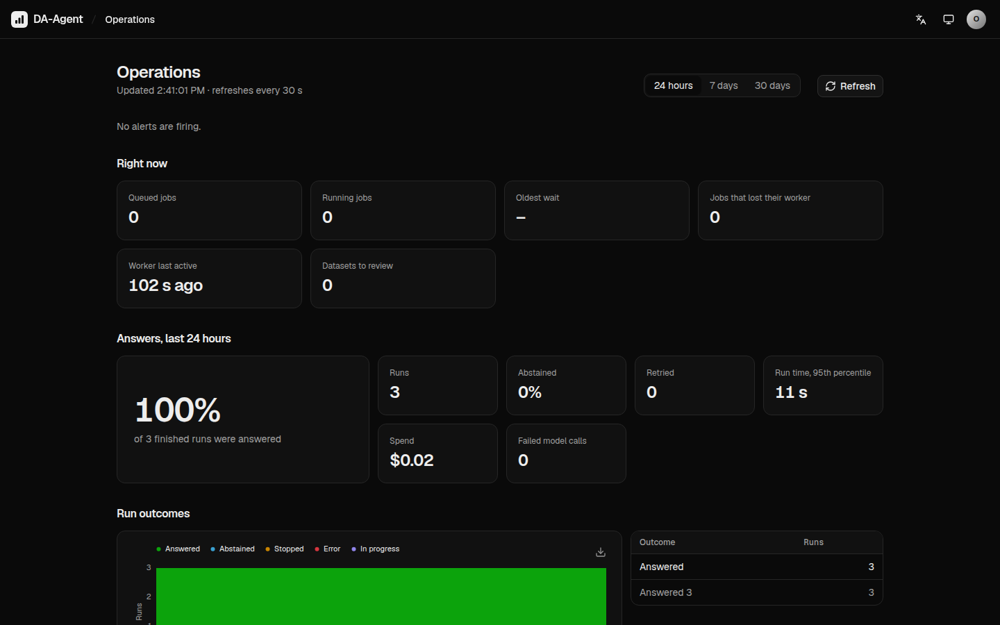
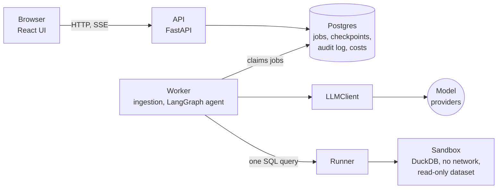
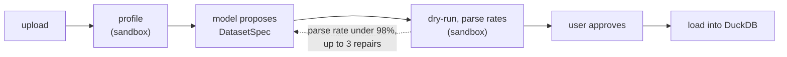
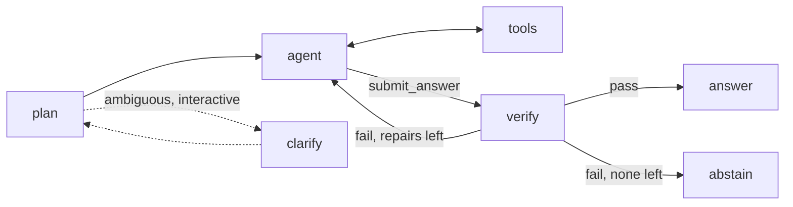

# DA-Agent

[](https://github.com/qnghi13/DA-Agent/actions/workflows/ci.yml)
[](https://github.com/qnghi13/DA-Agent/pkgs/container/da-agent)
[](LICENSE)


An open-source agent that analyses uploaded CSV, Excel, and SQLite files. You upload data with a
free-form description and ask questions. It answers with results you can trace back to the queries
that produced them.

> **Status:** a learning and portfolio project, complete for its plan: agent, ingestion, sandbox,
> HTTP API, web UI, operator dashboard, and Docker Compose packaging work and are tested. It has not
> run in production.

https://github.com/user-attachments/assets/dc2bf6b4-7ae1-4237-b2e6-f531cc7c8d34

*A 2½-minute narrated walkthrough: upload a café's sales export, review the proposed spec, ask
questions in English and Vietnamese, and see the SQL behind each answer.*



<table>
  <tr>
    <td></td>
    <td></td>
  </tr>
  <tr>
    <td>Review how uploaded files will be read before any question</td>
    <td>The operator dashboard: queue, outcomes, latency, model errors, cost</td>
  </tr>
</table>

## Highlights

- **Measured on unseen data.** On 150 questions from 6 shops held out from development and run
  once, 60% correct and 9% abstained, at about $0.002 and 6 seconds (median) per question with
  `gpt-oss-20b`. A wrong answer costs a point, so the agent abstains rather than guess
  ([Evaluation](#evaluation)).
- **Generated code never runs on the host.** File parsing and every SQL query run in containers
  without network or secrets, behind a read-only SQL guard. Escape attempts are tests.
- **Answers are checked by code, not by another model.** Numbers must come from query results,
  periods must fall inside the data, and joins must not double-count. A failed check gets two
  repairs, then the agent abstains.
- **Crash-safe and budgeted.** Every model turn is a Postgres checkpoint, so a killed worker's
  run resumes without repeating steps. Token and money limits per run and workspace, a circuit
  breaker for model providers, cancel, and deadlines.
- **Operable.** OpenTelemetry traces, a cost ledger per model call, an audit log, an operator
  dashboard, and Prometheus SLO alerts.
- **Decisions on record.** 48 [architecture decision records](docs/adr/README.md), a
  [threat model](docs/threat-model.md), and about 1,800 Python and 160 web tests in CI.

What measuring taught: the largest gain came from data preparation, not from the agent. Removing
double entries that code can prove took one shop's score from −11 to +13, while the LangGraph
workflow scored the same as a plain tool loop. A one-shot text-to-SQL prompt on the same prepared
data scores +40 against the agent's +61, at 45% of the cost: the agent mostly answers more
questions, not better ones. The workflow stays for checkpoints and verification, not for score.

## Quick start

Requires Docker Engine 26 or later with the Compose plugin, and a [Groq](https://console.groq.com)
API key (free tier).

```bash
cp .env.example .env          # then fill in the three required values
docker compose up -d --build  # the first build takes a few minutes
docker compose exec api python -m da_agent.admin create-workspace "My shop"   # prints its id and a key
docker compose exec api python -m da_agent.admin login-link --workspace WORKSPACE_ID
```

Open the printed link within 15 minutes; it signs the browser in and works once. Upload the three
files in `examples/demo-shop/`, approve the proposed spec, then ask "What was the revenue in June
2026?" (8,714,000 VND). "Invite or add a device" in the UI makes more links for the workspace.

For the operator dashboard (queue, outcomes, latency, model errors, cost against budgets, recent
failures), run `login-link --operator` and open that link. Traces are in Phoenix at
http://127.0.0.1:6006. If the UI is not served from http://127.0.0.1:8080, set
`DA_AGENT_PUBLIC_URL` to its address: links point there, and the API refuses changes from other
origins.

Before you upload your own data, know what leaves the machine: column profiles, sample values,
and query results go to the model provider. Sandboxes are containers (runc) without network
access, which is not a hard boundary against kernel exploits. See the
[threat model](docs/threat-model.md).

To run a released version without building, set `DA_AGENT_IMAGE=ghcr.io/qnghi13/da-agent` and
`DA_AGENT_TAG` (for example `0.1.0`) in `.env`, then `docker compose pull` and
`docker compose up -d --no-build`. Releases are published from version tags
([ADR 0028](docs/adr/0028-release-images-to-ghcr.md)).

`deploy/smoke.sh` checks a running stack without calling a model. `docker compose down` stops it;
add `-v` to delete all data.

## How it works



The same system drawn as one bench, with numbers that follow a question through it:

<picture>
  <source media="(prefers-color-scheme: dark)" srcset="docs/images/architecture-dark.svg" />
  
</picture>

1. **Browser** (the terminal): the React UI, talking to the API over HTTP and SSE (two cables).
2. **API** (the intake box): FastAPI. It checks sign-in, scopes each request to a workspace, and
   queues a job; it never runs generated code or calls a model.
3. **Postgres** (the card cabinet): four drawers for jobs, checkpoints, the audit log, and costs.
4. **Worker** (the carriage on rails): claims a job card from the open drawer and runs ingestion
   and the LangGraph agent.
5. **LLMClient** (the teleprinter with an antenna): the only part that reaches model providers.
6. **Runner** (the airlock): starts sandboxes. The lit card in its slot is a SQL query, the only
   thing that goes in.
7. **Sandbox** (the glass box): no cables, so no network and no secrets, and one dataset clamped
   down read-only.

Results come back the same way: runner to worker, worker to Postgres, and the API streams progress
and the answer to the browser.

- **Messy files become a reviewable spec.** Code profiles each upload inside a sandbox. The model
  proposes a declarative `DatasetSpec` (types, number and date formats, rows to exclude,
  sensitive columns), code dry-runs it and reports parse rates, and the user approves it before
  anything is queried ([ADR 0006](docs/adr/0006-dataset-spec.md)).



- **Generated SQL runs in a sandbox.** A SQL guard allows read-only queries, and each query runs in
  a container without network or secrets that sees one dataset
  ([ADR 0009](docs/adr/0009-parse-uploads-in-sandbox.md),
  [ADR 0011](docs/adr/0011-sql-per-request-sandbox.md)).
- **Answers are checked by code.** Numbers must come from query results, periods must fall inside
  the data, joins must not double-count, and unparseable values withhold the answer. Failed checks
  get two repairs, then the agent abstains ([ADR 0007](docs/adr/0007-code-first-verification.md)).



- **Results leave in full.** A query's whole result downloads as CSV (up to 1,000,000 rows),
  re-run in a sandbox from the stored query; charts download as PNG or SVG
  ([ADR 0032](docs/adr/0032-result-export.md)).
- **Runs survive crashes and stay within budget.** Every model turn is a Postgres checkpoint, so a
  killed worker's run continues without repeating finished steps. Token and money limits apply per
  run and per workspace.
- **Operable.** OpenTelemetry traces in Phoenix, a cost ledger per model call, an audit log, and an
  operator dashboard for queue health, outcomes, latency, model errors, and cost.
- **Measured.** An evaluation harness with a separate scorer process, fixed dev and holdout
  splits, and a cost report for every run. See [Evaluation](#evaluation).

## Evaluation

On the [DataMate](docs/eval/README.md) benchmark of messy Vietnamese retail data, scored +1
correct, −1 wrong, 0 abstained, with Groq `gpt-oss-20b` and the full pipeline from raw files.
The dataset is from challenge.zalo.ai, used for non-commercial, educational purposes under its
rules; it is not in this repository and is not redistributed.


| Set | Correct | Wrong | Abstained | Score | Cost |
|---|---|---|---|---|---|
| 150 dev questions (24 shops) | 62% | 27% | 11% | +53 | $0.38 |
| 150 holdout questions (6 unseen shops, run once) | 60% | 31% | 9% | +44 | $0.30 |
| Same 150 dev questions, current agent (2026-11-24) | 65% | 25% | 10% | +61 | $0.33 |
| Same 150 dev questions, one-shot text-to-SQL baseline | 51% | 24% | 25% | +40 | $0.15 |

Holdout is within noise of dev. The baseline reads the same prepared data and the whole
rulebook, writes one query, and answers from it. The agent adds +21, mostly by answering more
questions (135 against 112) rather than by answering them better (73% of answers right against
68%): the baseline abstains when the model wants a second query. Details, the history of changes, and caveats are in
[docs/eval](docs/eval/README.md).

## Documentation

- [Architecture](docs/architecture.md)
- [Operations](docs/operations.md): running without Compose, time travel, golden reruns, alerts
- [Evaluation results](docs/eval/README.md)
- [Threat model](docs/threat-model.md)
- [Decision records](docs/adr/README.md)
- [Plan and roadmap](docs/plan.md)
- [Current progress](docs/progress.md)
- [Learning notes, in Vietnamese](docs/learning/README.md)

## Development

Requires [uv](https://docs.astral.sh/uv/) and Python 3.12.

```bash
uv sync
uv run pytest
uv run ruff check .
uv run pyright          # src, eval, sandbox, and scripts
```

Tests that need Postgres are skipped unless `DA_AGENT_TEST_POSTGRES_URL` is set; each test runs in
its own schema. To run the backend without Compose, and for the operator tools, see
[Operations](docs/operations.md).

The project was built with Claude Code. `CLAUDE.md`, `.claude/settings.json`, the hooks, agents,
and the `tdd` and `agent-architecture` skills are part of the repo. Third-party skills are not
committed; restore them if you want the same setup (needs Node):

```bash
npx skills experimental_install          # the versions pinned in skills-lock.json
playwright-cli install --skills          # from @playwright/cli, for browser checks of the UI
```

## Running the web UI

The UI needs Node 22: React, Tailwind CSS, and shadcn/ui components
([ADR 0027](docs/adr/0027-tailwind-and-shadcn-ui.md)). In development Vite proxies `/v1` to the
API, so both share one origin.
Set `DA_AGENT_API_URL` if the API is not on `http://127.0.0.1:8000`.

```bash
cd web
npm ci
npm run dev          # http://localhost:5173; open a login link (the API needs
                     # DA_AGENT_PUBLIC_URL=http://localhost:5173)
npm test             # unit tests (vitest)
npm run build        # type-check and bundle into web/dist
```

## License

[Apache-2.0](LICENSE). Third-party material and its licenses: [THIRD_PARTY_NOTICES.md](THIRD_PARTY_NOTICES.md).
